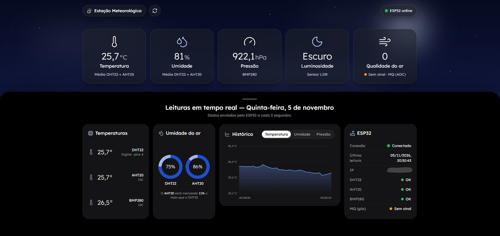
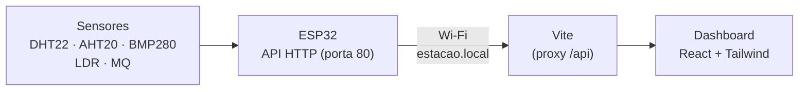

<div align="center">

# Estação Meteorológica ESP32

**Estação meteorológica montada em protoboard com ESP32, com API HTTP própria e um dashboard web em tempo real.**




</div>

---

## Sobre o projeto

Projeto acadêmico desenvolvido em grupo. Um **ESP32** lê cinco sensores ligados em uma protoboard (temperatura, umidade, pressão, luminosidade e gás) e disponibiliza as leituras por uma **API HTTP** na rede Wi-Fi. Um **dashboard em React** consulta essa API a cada 3 segundos e mostra os dados em tempo real.

Quando a placa está desligada, o dashboard continua funcionando e mostra **`NaN`** nos lugares onde os dados vão aparecer. Assim que o ESP32 conecta, as informações sobem sozinhas.

## Funcionalidades

-  **Leituras em tempo real**, atualizadas a cada 3 segundos
-  **Detecção de conexão**: estados *Conectando*, *Online* e *Offline*, com `NaN` quando não há dados
-  **Céu dinâmico**: o fundo vira dia ou noite de acordo com o sensor de luz (LDR)
-  **Efeito de chuva** quando a umidade passa de 85%
-  **Histórico** das últimas 40 leituras, com gráfico de temperatura, umidade ou pressão
-  **Comparação entre sensores**: temperatura e umidade de cada sensor lado a lado
-  **Status de cada sensor** (OK, Falhou, Sem sinal)
-  **Painel arrastável**: puxe o painel escuro para baixo para ver o céu inteiro
-  **Endereço fixo na rede** via mDNS: `http://estacao.local`, sem precisar procurar o IP

## Arquitetura



O front não acessa o ESP32 diretamente pelo navegador. O **proxy do Vite** repassa as chamadas `/api/*` para a placa, o que evita o bloqueio de CORS sem precisar alterar o firmware.

## Hardware

| Componente | Função | Ligação no ESP32 |
|---|---|---|
| **DHT22** | Temperatura e umidade | Dados → GPIO **4** |
| **AHT20** | Temperatura e umidade (I2C) | SDA → GPIO **21** · SCL → GPIO **22** |
| **BMP280** | Temperatura e pressão (I2C) | SDA → GPIO **21** · SCL → GPIO **22** |
| **Módulo LDR** | Claro / escuro (saída digital) | DO → GPIO **35** |
| **Sensor MQ** | Gases / qualidade do ar (analógico) | A0 → GPIO **34** |

>  O sensor MQ funciona em 5 V, mas os pinos do ESP32 aceitam no máximo 3,3 V. Use um divisor de tensão entre o A0 do MQ e o GPIO 34.

## API do ESP32

| Método | Rota | Descrição |
|---|---|---|
| `GET` | `/` | Verifica se a API está no ar |
| `GET` | `/api/dados` | Leituras de todos os sensores |
| `GET` | `/api/status` | Estado do Wi-Fi e dos sensores I2C |

<details>
<summary><strong>Exemplo de resposta: <code>/api/dados</code></strong></summary>

```json
{
  "dispositivo": "ESP32",
  "luminosidade": "ESCURO",
  "nivel_gas": 0,
  "dht22": { "temperatura_c": 26.3, "umidade_percentual": 76.1 },
  "aht20": { "temperatura_c": 26.44, "umidade_percentual": 86.59 },
  "bmp280": { "temperatura_c": 27.29, "pressao_pa": 92165.38 }
}
```

Leituras inválidas chegam como `null`, e o dashboard exibe `NaN`.

</details>

<details>
<summary><strong>Exemplo de resposta: <code>/api/status</code></strong></summary>

```json
{
  "wifi_conectado": true,
  "ip": "192.168.18.68",
  "aht20_disponivel": true,
  "bmp280_disponivel": true
}
```

</details>

## Estrutura do projeto

```
├── firmware/
│   └── Api_plus_cod/
│       ├── Api_plus_cod.ino        # Código do ESP32 (sensores + API)
│       └── secrets.example.h       # Modelo do arquivo com o Wi-Fi
├── src/
│   ├── api/                        # Cliente HTTP e rotas da estação
│   ├── components/
│   │   ├── ui/                     # Peças genéricas (Card, Donut, Gráfico...)
│   │   ├── layout/                 # Céu, chuva, header, painel arrastável
│   │   └── sensors/                # Cards de cada sensor
│   ├── config/                     # Configurações (intervalo, timeout)
│   ├── hooks/                      # usePolling, useEstacao, useArrastarPainel
│   ├── pages/                      # Dashboard
│   ├── types/                      # Tipos do JSON da API
│   └── utils/                      # Formatação e regras dos sensores
├── .env.example                    # Modelo das variáveis de ambiente
└── vite.config.ts                  # Tailwind + proxy para o ESP32
```

##  Como rodar

### Firmware (ESP32)

1. Instale o [Arduino IDE](https://www.arduino.cc/en/software) e o pacote de placas **esp32 by Espressif Systems**.
2. Instale as bibliotecas: **DHT sensor library**, **Adafruit AHTX0**, **Adafruit BMP280 Library** e **Adafruit Unified Sensor**.
3. Na pasta `firmware/Api_plus_cod/`, copie `secrets.example.h` para **`secrets.h`** e coloque o nome e a senha da sua rede Wi-Fi (2.4 GHz).
4. Abra `Api_plus_cod.ino`, selecione a placa **ESP32 Dev Module** e a porta COM, e clique em **Carregar**.
5. No Monitor Serial (115200 baud), confira as linhas `IP:` e `Nome na rede: http://estacao.local`.

### Dashboard (front-end)

Requisitos: [Node.js](https://nodejs.org/) 20 ou superior.

```bash
# Instalar as dependências
npm install

# Criar o arquivo de configuração
cp .env.example .env        # no Windows (cmd): copy .env.example .env

# Rodar
npm run dev
```

Acesse **http://localhost:5173**. O computador precisa estar na **mesma rede Wi-Fi** do ESP32.

### Variáveis de ambiente (`.env`)

| Variável | Exemplo | Descrição |
|---|---|---|
| `ESP32_URL` | `http://estacao.local` | Endereço do ESP32 (pode ser o IP) |
| `VITE_POLLING_MS` | `3000` | Intervalo entre as atualizações, em ms |

## Tecnologias

**Firmware:** C++ (Arduino) · WiFi · WebServer · ESPmDNS · Adafruit AHTX0 · Adafruit BMP280 · DHT sensor library

**Front-end:** React · TypeScript · Tailwind CSS v4 · Vite · lucide-react

## 👥 Equipe

| Integrante | Liderança | Responsabilidades |
|---|---|---|
| [**Jefferson Rezende**](https://github.com/jeffersonrezende2007) |  Front-end | Dashboard web em React, integração com a API e interface em tempo real |
| [**Victor**](https://github.com/Vhcor) |  Hardware | Montagem da protoboard, ligação dos sensores e testes físicos |
| [**Nicolas**]  Back-end | Firmware do ESP32 e desenvolvimento da API HTTP |
| [**Greta**]  Documentação | Documentação técnica do projeto e relatórios |
| [**Adailton**](https://github.com/Adailtonn28) |  Pesquisa | Levantamento do local, escolha da placa e dos sensores, pesquisa de preços e orçamento |

---

<div align="center">

Projeto desenvolvido para a disciplina de **Projetos** · **UNIP** · 2026

</div>
